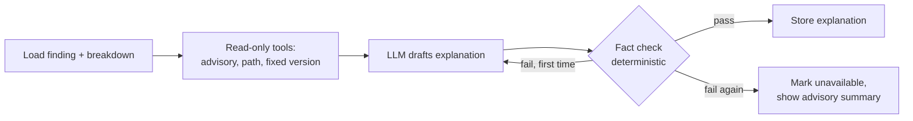

# ADR-0013: LangGraph for the explanation agent
- Status: Accepted for the framework. **The LLM provider is Proposed** and will be decided in the agent phase.
- Date: 2026-10-28

## Context
DepGuard explains its top 5 findings in plain English for users without security training. The explanation
must contain **no invented facts**: every ID, version and number has to match stored data (success metric). The LLM
only **explains**; it never matches, scores or ranks ([ADR-0003](0003-risk-tiers-and-stored-scores.md)). It must use
a **free** LLM with tight rate limits, and DepGuard must keep working when the LLM is down.

## Options

**Option A: LangGraph**
- Models the agent as an explicit graph of steps with shared state, so the flow is visible and testable.
- Built-in support for loops, such as "if the fact check fails, retry once", and for tool calls.
- Langfuse integrates with it, so every step is traced.
- An extra dependency with its own concepts to learn.

**Option B: a plain loop written by us** (call the LLM, run any requested tool, repeat)
- No framework; fewer concepts; easy to read.
- We would build state handling, retries and tracing hooks ourselves; the flow becomes harder to change and to
  show as a diagram.

## Decision
**Option A: LangGraph**, with a deliberately small graph:

- **Tools are read-only** lookups of DepGuard's own stored data; no tool calls the internet or writes anything.
- **The fact checker is plain code:** it extracts every CVE/GHSA ID, version and number from the text and
  compares them with the stored finding. Anything unverified fails the check.
- **Graceful degradation:** an LLM error, timeout or rate limit leads to "unavailable"; scans, tiers and fixes are unaffected.

### LLM provider (*Proposed*)
To be chosen in the agent phase against these criteria: a free tier that allows this use, tool calling, rate limits
that cover 5 explanations per scan, and data-use terms we can accept. Candidates to evaluate then (terms change
often, so they'll be checked at that time): Google Gemini's free tier, Groq, and free models on OpenRouter. The model
is a configuration setting, so switching providers doesn't change the graph.

## Trade-offs
- **Gain:** a visible, testable flow; a retry loop; tracing; an easy provider switch.
- **Give up:** one more framework to learn and explain. For a graph this small, a plain loop would also work.
  We accept LangGraph because the user's goal includes learning and explaining agent frameworks, and the graph stays readable.
- **Revisit if:** the graph stays this simple after the MVP. Replacing it with a plain loop would then be reasonable.
