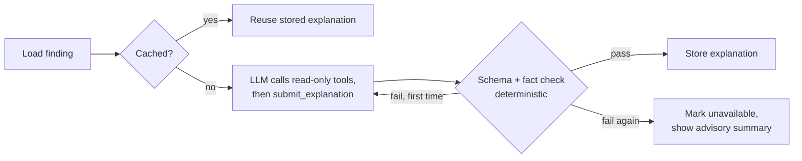

# ADR-0013: LangGraph for the explanation agent; Groq with a public-repo-only Gemini fallback
- Status: Accepted (framework: Phase 0; LLM provider: Phase 4a)
- Date: 2026-10-28

## Context
DepGuard explains its top 5 findings in plain English for users without security training. The explanation
must contain **no invented facts**: every ID, version and number has to match stored data (success metric). The LLM
only **explains**; it never matches, scores or ranks ([ADR-0003](0003-risk-tiers-and-stored-scores.md)). It must use
a **free** LLM with tight rate limits, and DepGuard must keep working when the LLM is down.

## Options

**Option A: LangGraph**
- Models the agent as an explicit graph of steps with shared state, so the flow is visible and testable.
- Built-in support for loops, such as "if the fact check fails, retry once", and for tool calls.
- Langfuse integrates with it, so every step is traced.
- An extra dependency with its own concepts to learn.

**Option B: a plain loop written by us** (call the LLM, run any requested tool, repeat)
- No framework; fewer concepts; easy to read.
- We would build state handling, retries and tracing hooks ourselves; the flow becomes harder to change and to
  show as a diagram.

## Decision
**Option A: LangGraph**, with a deliberately small graph:

- **Tools are read-only** lookups of DepGuard's own stored data: dependency path, advisory details, fixed
  version. Each is bound to the one finding being explained and takes no arguments, so text in an advisory can't
  point it at other data. No tool calls the internet or writes anything.
- **The output is a `submit_explanation` tool call** whose arguments are a validated schema (summary, why it
  matters, what to do, cited IDs). It has no score, tier or fix-version fields: those are shown from stored data.
  Groq can't combine its structured-output mode with tool calling, and a final tool call works on both providers.
- **The fact checker is plain code:** it extracts every CVE/GHSA ID, version and number from the text and
  compares them with the stored finding. Anything unverified fails the check.
- **Limits:** at most 4 tool calls per attempt (or fewer: once all three tools were read, only
  `submit_explanation` is offered), a timeout per LLM call and a deadline per finding.
- **Tokens:** a tool's result is sent in full once (a repeated call gets a short reminder), tool output is compact
  JSON without empty fields, advisory details are cut to 600 characters, and gpt-oss runs with low reasoning effort.
- **Cache:** an explanation is reused while its inputs (advisory, package version, fixed version, score inputs,
  paths, prompt version, model) are unchanged, so rescans cost no LLM calls.
- **Graceful degradation:** if no provider is allowed or available, the explanation is skipped (`unavailable`);
  scans, tiers and fixes are unaffected.

### LLM provider (decided in Phase 4a)
Criteria: a free tier that allows this use, tool calling, limits that cover 5 explanations per scan, and
data-use terms we can accept. Checked on 2026-10-28 in the providers' docs:

| Provider | Model | Free limits | Data use | Role |
|---|---|---|---|---|
| **Groq** | `openai/gpt-oss-120b` (tool use + strict JSON schema) | 30 req/min, 1,000 req/day, 8,000 tokens/min, 200,000 tokens/day (confirmed on the console's organization limits page, free plan, 2026-10-29) | Inference data not retained by default, not used for training | **Primary** |
| **Gemini** | `GEMINI_MODELS`, in order: `gemini-3.6-flash`, then `gemini-3.8-flash` (Phase 4b; both listed with a free tier on the pricing page, 2026-10-29) | Shown only in AI Studio; to confirm there | Free-tier content **is used to improve Google's products** | **Fallback, public repos only** |
| OpenRouter `:free` | rotating | 20 req/min, 50 req/day without a $10 purchase | depends on each upstream host | Rejected |

**Rate limits (changed in Phase 4a after the first real run, where 3 of 5 explanations hit Groq's 8,000
tokens/min):**
- **Wait before the limit:** findings are explained one at a time, and each Groq call first waits until its
  estimated tokens fit in a tokens-per-minute budget (`GROQ_TOKENS_PER_MINUTE`, 7,500, kept below the limit).
  The budget is shared by every scan in the process and counts the tokens Groq reports.
- **Honour retry-after:** if a call still gets a 429, it waits as long as the provider says (the `retry-after`
  header, or Groq's "try again in 3.87s") and retries, **at most twice per call**, and only if the wait ends
  before the finding's deadline. A 429 that doesn't say how long, or a third one, counts as a Groq failure.
- Explanations of a fresh scan therefore take minutes, not seconds. They run after the scan is `done`, so
  nothing waits for them.

**Fallback rule:** when Groq fails (error, timeout, rate limit that can't be waited out), a Gemini key is set,
**and the repo is public** (`repos.is_private = false`, read from GitHub at each scan), the explanation comes from
the **first available model from the configured list** (`GEMINI_MODELS`, tried in order, each once). A repo whose
visibility is unknown counts as private. So the fallback switches off by itself for private repos once they are
supported. A failed fact check is not an outage and never triggers the fallback. If every allowed model fails, or
the fallback isn't allowed, the explanation is skipped (`unavailable`).

**Why a list with a short timeout (changed in Phase 4b):** the first real fallback run found
`gemini-3.8-flash` overloaded (503 "high demand", or 504 after the full timeout; one call took 200 s) while
`gemini-3.5-flash` answered in about a second. Google's model page says `gemini-3.5-flash` is deprecated and
its requests are routed to `gemini-3.6-flash`, so the list names 3.6 directly. Each Gemini call now has its own short timeout
(`GEMINI_TIMEOUT_SECONDS`, 20 s; 10 s was tried and was too short, since tool calls took 10–15 s under load),
so an overloaded model fails fast and the next one is tried, instead of holding the explanation until the
deadline. The order is a setting, so it can follow whichever free model is healthy without a code change.

**Gemini's free daily limit is small:** the Phase 4b run hit `GenerateRequestsPerDayPerProjectPerModel-FreeTier`,
**20 requests a day per model** (which also confirms these models are on the free tier). An explanation takes 2–5
calls, so each listed model covers about 4–10 fallback explanations a day. That is acceptable for a fallback that
only runs while Groq is failing; a longer Groq outage leaves the rest `unavailable`.

**Budget:** Groq's 8,000 tokens/min binds first: about 1 uncached explanation per minute and about 25 per day
(about 5 fresh scans). The cache and the top-5 limit keep normal use inside it. Models are settings, so switching
doesn't change the graph. The eval run (Phase 4b, [evals.md](../evals.md)) uses the same pacing, spends about
85,000 tokens per full run, and refuses to start if its cases could exceed 120,000 tokens, so it fits once a day.

## Trade-offs
- **Gain:** a visible, testable flow; a retry loop; tracing; an easy provider switch; no private-repo data
  reaches a provider that trains on it.
- **Give up:** one more framework to learn and explain. For a graph this small, a plain loop would also work.
  We accept LangGraph because the user's goal includes learning and explaining agent frameworks, and the graph stays readable.
- **Give up (provider):** a tight daily budget on Groq's free tier; Gemini's better limits only help public repos.
- **Revisit if:** the graph stays this simple after the MVP (a plain loop would then be reasonable), Groq's free
  limits or data terms change, or the daily budget is regularly used up.
