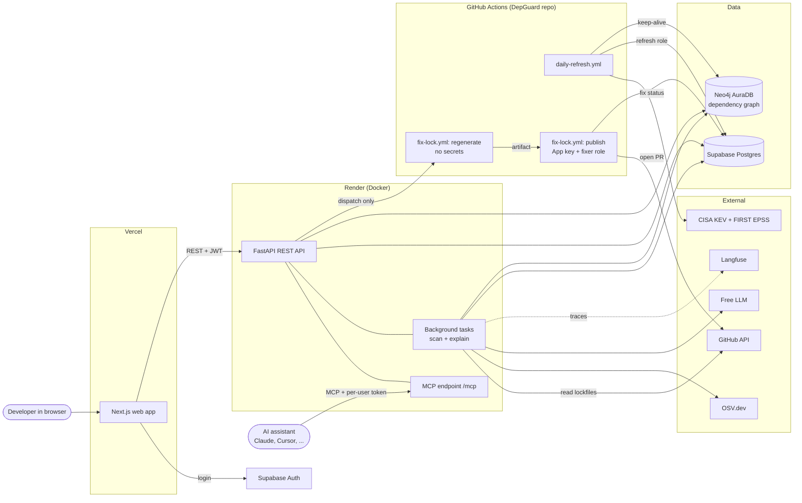
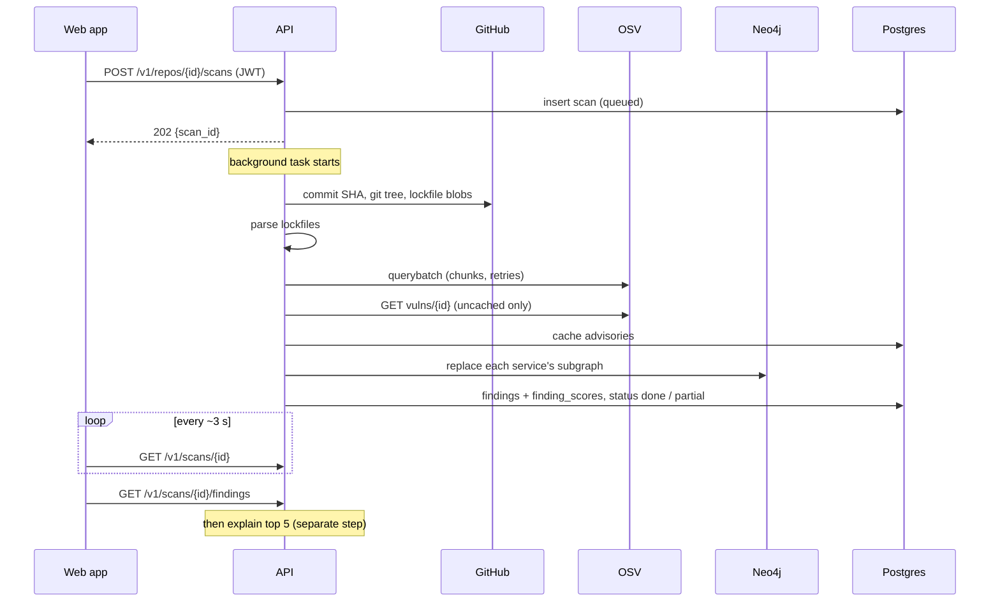
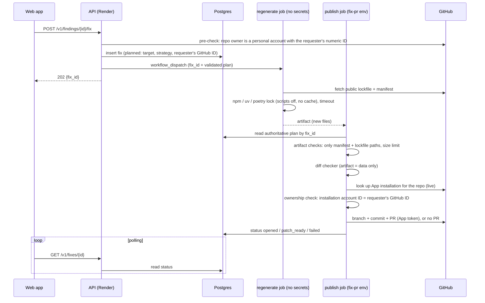
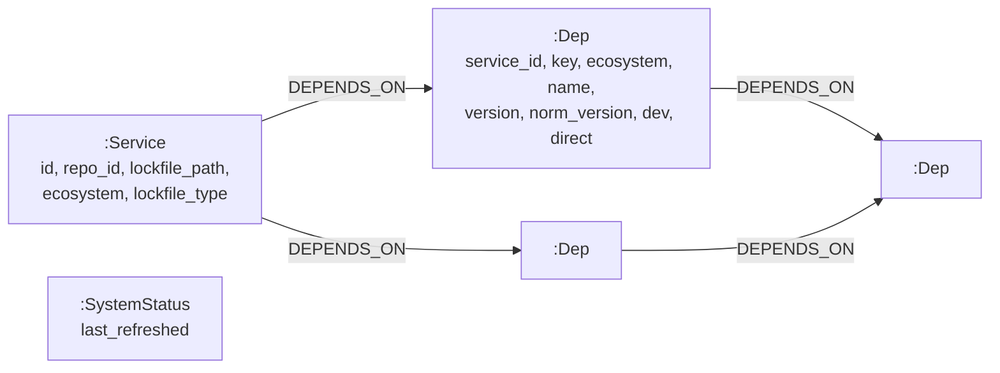
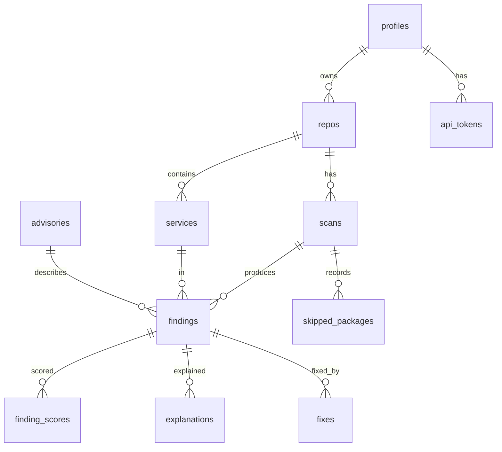

# DepGuard — Architecture

> Status: Phase 0 design · Last updated: 2026-10-28
> **What** and **why** are in [spec.md](spec.md). This document is the **how**. Each real design choice
> links to its decision record in [adr/](adr/README.md). Security details are in [security.md](security.md).

---

## 1. System overview



**In one paragraph:** the web app (Vercel) and AI assistants (MCP) are two front doors to one FastAPI
service (Render). The API stores records in Postgres and each service's dependency tree in Neo4j. Scans run in
the background inside the API. Two jobs run on GitHub Actions instead of Render: the **daily refresh** of KEV and
EPSS data, and **fix-PR building**, which runs untrusted package-manager code on a throwaway machine. The
GitHub App private key lives only in that workflow's protected environment, **not on Render**.

---

## 2. Components

| Component | Runs in | Responsible for |
|---|---|---|
| **Web app** (Next.js + TypeScript) | Vercel | Pages: sign in, repos, scan progress, ranked findings, finding detail, search, MCP tokens. Polls status. No business logic. |
| **Supabase Auth** | Supabase | GitHub login (identity only); issues the JWT the web app sends to the API. |
| **REST API** (FastAPI) | Render | Auth (JWT or API token), **ownership checks on every query**, limits, validation, starting background work, serving results. |
| **Scan pipeline** (`scan/`) | API background task | Runs the steps in section 3. Deterministic. |
| **Parsers** (`parsers/`) | API | One per lockfile type → entries (name, version, dev/prod, direct) and edges, or "skipped: version unknown". |
| **Advisory layer** (`advisories/`) | API | OSV batch matching with timeouts and retries; advisory cache; KEV/EPSS lookups; alias merging. |
| **Version logic** (`versions/`) | API + Actions | npm semver and PEP 440 comparison; first fixed version; major-bump flag. |
| **Graph layer** (`graph/`) | API | Writes each service's subgraph; path and "which services contain X?" queries; capacity check. |
| **Scoring** (`scoring/`) | API + daily job | Tier, subgroup, risk score, tie-breaker → one sort key. Pure functions. |
| **Explainer agent** (`agent/`, LangGraph) | API background task | Explains the top 5 with read-only tools over stored data; deterministic fact checker; Langfuse traces. |
| **Fix planner** (`fixes/`) | API | Decides *what* to change (direct bump, parent bump, override), pre-checks repo ownership, creates the `fixes` row, dispatches the workflow. Never touches the App key. |
| **fix-lock workflow** | GitHub Actions | `regenerate` job (untrusted, no secrets) → artifact → `publish` job (trusted): diff check, PR or patch, status to the database. |
| **MCP server** (`mcp_server.py`) | Mounted in the API at `/mcp` | 3 read-only tools; per-user API token; returns only the token owner's data. |
| **Daily refresh** (`jobs/daily_refresh.py`) | GitHub Actions (locally `make refresh` until deploy) | Download KEV and EPSS, rescore, keep both databases awake. Uses the restricted `depguard_refresh` role. |

---

## 3. Data flow: one repo scan



1. **Start.** The web app sends `POST /v1/repos/{repo_id}/scans` with the Supabase JWT. The API checks the JWT,
   that the repo belongs to the user, and that no scan of this repo is already running. It inserts
   `scans(status=queued)`, replies **`202 {scan_id}`**, and starts a background task
   ([ADR-0008](adr/0008-background-scans-in-process.md)).
2. **Fetch** (`running`). Get the default branch's commit SHA, then the file tree
   (`git/trees/{sha}?recursive=1`). Keep only `package-lock.json`, `poetry.lock`, `uv.lock` and
   `requirements*.txt`, plus any `.txt` inside a `requirements/` folder such as `requirements/base.txt` (files like `requirements-dev.txt` still count as production; see the spec's dev/prod rule).
   Skip anything inside a `node_modules`, `test`, `tests`, `__tests__`, `fixtures` or `testdata` folder (installed
   packages and test data, not services). At most 25 lockfiles per repo (more → partial reason) and 10 MB per file.
   For a `poetry.lock`, also fetch the `pyproject.toml` beside it, because only that file says which dependencies
   are direct. Download each through the blob API, which also works for files over 1 MB. If the tree
   comes back truncated, record a partial reason. Each lockfile becomes a **service**
   ([ADR-0012](adr/0012-fetch-lockfiles-via-tree-api.md)).
3. **Parse.** Each parser returns entries and edges. Unpinned requirements go to `skipped_packages`
   with reason `version_unknown`; git, URL and local-path packages with reason `not_from_registry` (OSV can't match them) ([ADR-0002](adr/0002-lockfiles-only-no-version-guessing.md)). PyPI names are
   normalised (PEP 503). A service with more than 5,000 entries, or a file that can't be parsed, fails that service only, with a clear
   message; the other services are still scanned.
4. **Match.** OSV `querybatch` in batches of at most 1,000 queries; results that come back in pages are followed
   until complete. Every call has a timeout and up to 3 retries with exponential backoff.
   If a chunk still fails, its packages are stored as `skipped_packages(reason=osv_unavailable)` and the scan will end
   as **`partial`**, never as `done` with silently fewer findings
   ([ADR-0004](adr/0004-vulnerability-data-sources.md)).
5. **Fetch advisory details.** Advisory IDs not yet in the `advisories` cache (or modified since) are fetched with
   `GET /v1/vulns/{id}` under the same retry rules. If that fails, the finding is kept with its ID only and the
   scan is `partial`. Withdrawn advisories are dropped. Aliases (GHSA / PYSEC / CVE) are merged, so one
   problem = one finding.
6. **Fixed version.** Computed by our code from the advisory's affected ranges: the smallest fixed version above
   the installed one, plus a major-bump flag.
7. **Graph.** Capacity check (section 5.1). If there's room, replace this service's subgraph in one transaction
   using batched writes. If not, skip the graph (findings are still stored), keep that service's previous graph,
   and add the partial reason "dependency paths unavailable: graph storage full". If Neo4j can't be reached, the
   reason is "dependency paths unavailable: graph database unreachable". Graphs of the repo's services that
   are gone or failed in this scan are deleted, so no stale paths remain.
8. **Score.** Look up KEV and EPSS by the finding's CVE alias. **Reach** = number of the user's services whose
   repo's latest *fully checked* scan contains the same package version and advisory (a repo with no fully
   checked scan counts its partial one, and reach is marked incomplete; ADR-0003). Compute tier, subgroup, risk score and tie-breaker
   ([ADR-0003](adr/0003-risk-tiers-and-stored-scores.md)), then write `findings` and
   `finding_scores(data_date)`.
9. **Finish.** `status=done`, or **`partial`** with `partial_reasons`. The UI shows a banner such as
   *"Partial scan: 37 packages could not be checked because OSV was unavailable. Re-run to complete."*
10. **Explain** (a separate step that never changes scan status). The top 5 findings go to the agent, then the fact
    checker; the explanation is stored (and reused while its inputs are unchanged), or marked `unavailable` if the LLM fails
    ([ADR-0013](adr/0013-explanation-agent-and-llm.md)).
11. **Show.** The web app polls `GET /v1/scans/{id}` about every 3 s, then loads `GET /v1/scans/{id}/findings`.

**Scan status values:** `queued` → `running` → `done` | `partial` | `failed`. An unrecoverable error gives `failed`
with a message. On API startup, scans stuck in `running` are set to `failed` ("server restarted").

### 3.1 Daily refresh ([ADR-0009](adr/0009-daily-refresh-on-github-actions.md))
Runs at 03:00 UTC on a schedule, and on demand through the manual "run now" trigger. Until the deploy phase the
databases are local, so it runs as `make refresh`; `daily-refresh.yml` exists with the manual trigger only, and the
schedule, its secret and the Neo4j write are added at deploy.
1. Download the KEV catalog (JSON) and the EPSS scores (compressed CSV).
2. Check each file looks complete (a cut-off download aborts and leaves the tables alone), round EPSS and its
   percentile to 3 decimals, and replace `kev_entries` and `epss_scores` in one transaction (latest snapshot only).
3. Rescore every service's latest scan; insert a `finding_scores` row only when an input changed.
4. Insert a `refresh_runs` row (keeps Supabase active) and `MERGE (:SystemStatus {last_refreshed})` in Neo4j
   (keeps Aura active).

### 3.2 Fix PR ([ADR-0010](adr/0010-fix-prs-built-in-github-actions.md))

- Render only **plans and dispatches**. It never holds the App private key and only reads fix status from Postgres.
- `regenerate` runs untrusted code (package-manager resolution, possible Python source builds) on a
  **fresh VM with no secrets**. `publish` runs on a **different fresh VM**, has the App key and the
  `depguard_fixer` database role, and treats the artifact purely as **data**.
- **No caching** in either job (no `actions/cache`, no setup-action caches), so the untrusted job can't plant files
  that the trusted job later loads.
- Before pushing, `publish` checks that the artifact contains **only the planned manifest and lockfile paths**, each
  within a **size limit**, then runs the diff checker.
- **Ownership is checked live, never from stored webhook data:**
  1. *Pre-check* (Render, for a quick answer): the repo's owner is a **personal** account whose **numeric GitHub ID**
     equals the requester's (the requester's ID comes from their Supabase GitHub identity, stored in `profiles`).
  2. *Authoritative check* (`publish`, which holds the App key): look up the App installation for that repo and allow
     the PR only if the installation's account is a user whose **numeric ID** equals the requester's. Numeric IDs
     are compared because usernames can be renamed and reused.
  3. If either check fails, or the App isn't installed, `publish` stores a **patch** instead of opening a PR.
     Organization repos come later.
- `publish` runs with `if: always()`, so a failed `regenerate` is still reported as `failed`.
- If a fix stays unfinished for more than 20 minutes, the API reports it as `failed` (timed out) when it is read.
- **Fix statuses:** `planned` (row created) → `dispatched` (workflow started) → `checking` (`publish` is
  verifying the output) → `opened` (PR created) | `patch_ready` (patch stored instead) | `failed`.
- DepGuard has **no webhook endpoint** in the MVP. If one is ever added, every delivery must be verified with the
  `X-Hub-Signature-256` header before anything is processed.

---

## 4. Design decisions (summary)

Every row was decided with two options compared; the reasoning is in the ADR.

| # | Question | Decision | ADR |
|---|---|---|---|
| 1 | How do we get write access for fix PRs? | GitHub App, writes only, chosen repos | [0001](adr/0001-github-app-over-oauth-repo-scope.md) |
| 2 | What do we read to know installed versions? | Lockfiles only; never guess | [0002](adr/0002-lockfiles-only-no-version-guessing.md) |
| 3 | How are findings ranked? | 3 tiers + score; recomputed and stored daily | [0003](adr/0003-risk-tiers-and-stored-scores.md) |
| 4 | Where does vulnerability data come from? | OSV `querybatch` + KEV/EPSS bulk files; `partial` on failure | [0004](adr/0004-vulnerability-data-sources.md) |
| 5 | Which database holds what? | Postgres = source of truth; Neo4j = dependency graph only | [0005](adr/0005-postgres-and-neo4j-split.md) |
| 6 | How fine-grained is the graph? | Separate nodes per service | [0006](adr/0006-per-service-graph-nodes.md) |
| 7 | Where is it hosted? | Vercel (web) + Render (API), free tiers | [0007](adr/0007-free-tier-hosting-vercel-and-render.md) |
| 8 | How do scans run in the background? | In the API process, with status tracking | [0008](adr/0008-background-scans-in-process.md) |
| 9 | Where does the daily refresh run? | GitHub Actions, restricted database role | [0009](adr/0009-daily-refresh-on-github-actions.md) |
| 10 | Where are fix PRs built? | GitHub Actions, two isolated jobs | [0010](adr/0010-fix-prs-built-in-github-actions.md) |
| 11 | How is MCP served and secured? | Mounted in the API, per-user tokens | [0011](adr/0011-mcp-in-api-with-user-tokens.md) |
| 12 | How are repos read? | Tree API + blobs with a read-only token | [0012](adr/0012-fetch-lockfiles-via-tree-api.md) |
| 13 | How are explanations generated? | LangGraph agent; Groq, then the first available Gemini model from a configured list, public repos only | [0013](adr/0013-explanation-agent-and-llm.md) |
| 14 | Which language and frameworks? | Python + FastAPI; Next.js + TypeScript | [0014](adr/0014-language-and-framework.md) |
| 15 | Which ecosystems? | npm and PyPI only | [0015](adr/0015-npm-and-pypi-scope.md) |

Smaller choices made here without an ADR:
- **Database access:** SQLAlchemy 2.0 + Alembic migrations (rather than the Supabase client or raw SQL),
  because it gives a versioned schema and tests against a local Postgres in Docker. One driver, asyncpg, for the
  API, migrations and the refresh (psycopg's async mode doesn't run on Windows' default event loop).
- **Repo layout:** one repository with `apps/api` and `apps/web` (rather than two repos), so one phase = one PR.

---

## 5. Data model

### 5.1 Neo4j: dependency graph ([ADR-0006](adr/0006-per-service-graph-nodes.md))



- **`Dep` nodes belong to exactly one service.** Edges only ever connect nodes of the same service, so a
  path can't jump to another lockfile.
- **`key`** = the npm lockfile install path (e.g. `node_modules/a/node_modules/b`), or
  `normalised-name==version` for Python (a Python lockfile can hold two versions of one package, one per Python
  version). Keying npm by path keeps two copies of the same package inside one lockfile apart.
- **`DEPENDS_ON` edges carry `ambiguous`.** poetry.lock names a dependency's package but not its version. When
  the lock holds several versions, the dependency's version constraint and markers pick one
  (`parsers/poetry_constraints.py`, checked against Python 2.7 and 3.6–3.14 on Linux, Windows and macOS). If more than
  one is still possible, there is an edge to each, marked `ambiguous: true`, and path results show it. Every
  other lockfile type records exact edges.
- **Vulnerabilities are not stored in Neo4j.** Postgres `findings` records the `dep_key`, and the graph is used for
  paths and package lookups.

**Indexes and constraints**
```cypher
CREATE CONSTRAINT service_id  FOR (s:Service) REQUIRE s.id IS UNIQUE;
CREATE CONSTRAINT dep_key     FOR (d:Dep)     REQUIRE (d.service_id, d.key) IS UNIQUE;
CREATE INDEX      dep_package_norm FOR (d:Dep) ON (d.ecosystem, d.name, d.norm_version);
CREATE INDEX      dep_service  FOR (d:Dep)     ON (d.service_id);  // a service's whole tree
CREATE INDEX      service_repo FOR (s:Service) ON (s.repo_id);     // finding a repo's stale services
```

**Queries**
```cypher
// Paths to a vulnerable entry (dep_key comes from Postgres findings); up to 3 shortest
MATCH (s:Service {id: $service_id}), (d:Dep {service_id: $service_id, key: $dep_key})
MATCH p = allShortestPaths((s)-[:DEPENDS_ON*]->(d))
RETURN p LIMIT 3;

// Which of the user's services contain package X (uses dep_package_norm)
MATCH (d:Dep {ecosystem: $eco, name: $name, norm_version: $normalised_version})
WHERE d.service_id IN $user_service_ids
RETURN DISTINCT d.service_id;
```
`$user_service_ids` always comes from Postgres for the signed-in user, so a graph query can't return another
user's services. `norm_version` is the version in one spelling per ecosystem (`versions/`: PEP 440 via
`packaging`, SemVer via `semver`), so `1.0` finds `1.0.0`; `version` keeps the lockfile's spelling for display.

**Capacity:** the formula and current numbers are in [spec §8.1](spec.md#graph-capacity-neo4j-auradb-free).
In short, relationships (N × d per service) run out first unless `d` is about 2 or lower. The graph keeps only each service's latest
scan, and writes stop at 90% of either limit.

### 5.2 Postgres (Supabase)



| Table | Key columns | Notes |
|---|---|---|
| `profiles` | `user_id` (Supabase auth id), `github_id` (numeric), `github_login`, `created_at` | `github_id` is used for ownership checks; the login is for display only |
| `api_tokens` | `id`, `user_id`, `prefix`, `token_hash`, `name`, `last_used_at`, `revoked_at` | Raw token shown once; only the SHA-256 hash is stored |
| `repos` | `id`, `user_id`, `owner`, `name`, `default_branch`, `is_private` (from GitHub each scan; null = private, no Gemini) | Unique (`user_id`, `owner`, `name`); max 10 per user. App installations aren't stored; they're looked up live |
| `services` | `id`, `repo_id`, `lockfile_path`, `ecosystem`, `lockfile_type` | One per lockfile |
| `scans` | `id`, `repo_id`, `status`, `partial_reasons` (jsonb), `commit_sha`, `data_date`, `created_at`, `started_at`, `finished_at`, `duration_ms`, `error`, `osv_complete` | Status: queued / running / done / partial / failed |
| `skipped_packages` | `scan_id`, `service_id`, `name`, `spec`, `reason` | `version_unknown`, `not_from_registry` or `osv_unavailable` |
| `advisories` | `id`, `aliases[]`, `summary`, `cvss_score`, `cvss_vector`, `cvss_version`, `is_malicious`, `withdrawn`, `modified`, `raw` (jsonb), `fetched_at` | OSV cache; `raw` is null for an ID whose details couldn't be fetched yet (retried next scan) |
| `kev_entries` | `cve_id`, `date_added`, `due_date`, `known_ransomware` | Replaced daily |
| `epss_scores` | `cve_id`, `score`, `percentile`, `data_date` | Latest snapshot only (fits the 500 MB limit); rounded to 3 decimals |
| `findings` | `id`, `scan_id`, `service_id`, `dep_key`, `ecosystem`, `package`, `installed_version`, `installed_version_norm`, `advisory_id`, `aliases[]`, `summary`, `cvss`, `is_malicious`, `fixed_version`, `major_bump`, `is_dev`, `is_direct`, `is_bundled` | One per (entry, merged advisory). `advisory_id` = the group's main ID; `aliases` = every ID in the group (CVEs for KEV/EPSS); `cvss` = the group's highest |
| `finding_scores` | `finding_id`, `data_date`, `in_kev`, `epss`, `epss_percentile`, `cvss`, `reach`, `reach_complete`, `tier`, `subgroup`, `risk_score`, `created_at` | New row only when an input changes; the newest row is the current score |
| `explanations` | `finding_id`, `cache_key`, `data_date`, `status` (`ok`/`unavailable`), `text`, `model`, `trace_id`, `fact_check_passed`, `cache_hit`, `error` | One row per attempt, newest = current; the API may only insert and read. Same `cache_key` in the same repo → text reused |
| `fixes` | `id`, `finding_id`, `requested_by_github_id`, `strategy`, `target_version`, `status`, `workflow_run_id`, `pr_url`, `patch`, `error`, `created_at`, `updated_at` | Statuses explained in §3.2 |
| `refresh_runs` | `id`, `ran_at`, `status`, `kev_count`, `epss_count`, `epss_date`, `rescored`, `error` | Written by the daily job, also when it fails |

### 5.3 Database roles and row-level security
Supabase exposes tables through its Data API, so **row-level security (RLS) is enabled on every table**. With RLS on,
a role sees **no rows** unless a policy allows it. DepGuard uses three login roles. None of them owns the tables,
none has `BYPASSRLS`, and each gets both `GRANT`s (which tables and columns) **and** explicit policies (which rows).
Migrations run as the owner role.

**What RLS does and doesn't do here:** it keeps Supabase's Data API out, and limits what each *job* (API, daily
refresh, fix publish) can touch. It does **not** separate one user from another: that is enforced in API code
and proven by cross-user tests ([security.md §7](security.md#7-user-data-isolation-t4)).

| Role | Used by | Access |
|---|---|---|
| `depguard_api` | Render API | Read/write on application tables through policies; `SELECT` only on `kev_entries`, `epss_scores`, `refresh_runs`. Per-user isolation is enforced in API code and tested. |
| `depguard_refresh` | Daily job | Full access to `kev_entries`, `epss_scores`; `INSERT, SELECT` on `refresh_runs`; `SELECT` on `findings`, `scans`, `services`, `advisories` and `repos(id, user_id)`; `SELECT, INSERT` on `finding_scores` (it must read the latest score to know whether an input changed); nothing else |
| `depguard_fixer` | Fix `publish` job | `SELECT` on `fixes`, `findings`, `services(id, repo_id, lockfile_path)` and `repos(id, owner, name)`; `UPDATE` on `fixes` status/result columns only |

- Supabase's built-in `anon` and `authenticated` roles get **no** policies, so the Data API returns nothing.
- `TRUNCATE` skips row policies, so it is granted only where a full-table replace is the point
  (`kev_entries`, `epss_scores`).
- The exact SQL lives in the migrations; [security.md](security.md) explains each grant.
- Row-level security blocks `COPY`, so the refresh loads EPSS with one `INSERT … SELECT FROM unnest(arrays)`.
- The migration creates the roles without a login; `make migrate` then sets each role's password from its own
  URL (`DATABASE_URL`, `REFRESH_DATABASE_URL`), so the password exists in one place only.

---

## 6. API endpoints

Prefix `/v1`. Auth is the Supabase JWT unless noted. Requests for another user's resources return `404`, so
the API doesn't reveal what exists.

| Method & path | Purpose | Success |
|---|---|---|
| `GET /health` | Liveness (no auth) | 200 |
| `GET /data-status` | KEV/EPSS data date (freshness metric) | 200 |
| `GET /me` | Current user | 200 |
| `GET /github/public-repos` | The user's public repos to pick from | 200 |
| `GET /repos` · `POST /repos` · `DELETE /repos/{id}` | Manage repos (max 10; pick or URL) | 200 · 201 · 204 |
| `POST /repos/{id}/scans` · `GET /repos/{id}/scans` | Start a scan · history | **202** · 200 |
| `GET /scans/{id}` | Status, incl. `partial` reasons | 200 |
| `GET /scans/{id}/findings?tier=` | Ranked findings | 200 |
| `GET /findings/{id}` | Breakdown, paths, explanation, fixed version | 200 |
| `POST /findings/{id}/explanation` | Retry an explanation | 202 |
| `GET /vulnerabilities/{id}/affected-services` | "Where am I affected?" by CVE/GHSA | 200 (empty list ok) · 404 · 422 |
| `GET /packages/{ecosystem}/{name}/affected-services` | "Where am I affected?" by package | 200 |
| `POST /findings/{id}/fix` · `GET /fixes/{id}` | Start a fix · read its status | 202 · 200 |
| `GET /github/app/install-url` | Link to install the App on chosen repos | 200 |
| `GET /tokens` · `POST /tokens` · `DELETE /tokens/{id}` | MCP tokens (raw token shown once) | 200 · 201 · 204 |
| `/mcp` | `list_top_risks`, `am_i_affected`, `explain_finding` (**per-user API token**) | — |

**User story → endpoint:** 1 → `/repos`, `/github/*` · 2–3 → `/scans/*`, `/findings/{id}` · 4 →
`/*/affected-services` · 5 → `/findings/{id}/explanation` · 6 → `/fix`, `/fixes/{id}` · 7 → `/mcp`.

---

## 7. Folder structure

```
depguard/
├─ apps/
│  ├─ api/
│  │  ├─ pyproject.toml          # dependencies, managed with uv
│  │  ├─ Dockerfile              # Render image (no npm/poetry needed: fixes run in Actions)
│  │  ├─ alembic/                # Postgres migrations, roles, RLS policies
│  │  ├─ scripts/                # compare_osv_scanner.py (correctness check, spec §7)
│  │  ├─ src/depguard/
│  │  │  ├─ main.py              # app setup: routers, /mcp mount, CORS
│  │  │  ├─ config.py            # settings from environment variables
│  │  │  ├─ auth.py              # JWT and API-token checks
│  │  │  ├─ mcp_server.py        # the 3 read-only MCP tools
│  │  │  ├─ routes/              # one file per resource group
│  │  │  ├─ db/                  # SQLAlchemy models, sessions, Neo4j driver
│  │  │  ├─ github/              # read client, repo-owner pre-check, workflow dispatch
│  │  │  ├─ scan/                # ingest, match, graph, pipeline (steps 2–9)
│  │  │  ├─ parsers/             # npm_lock, poetry_lock, uv_lock, requirements_txt
│  │  │  ├─ versions/            # npm semver, PEP 440, fixed version, major bump
│  │  │  ├─ advisories/          # osv, cache, aliases, cvss, feeds (KEV + EPSS)
│  │  │  ├─ graph/               # writer, queries, capacity check
│  │  │  ├─ scoring/             # score (tier, risk score, sort key), rescore
│  │  │  ├─ agent/               # LangGraph graph, tools, fact checker
│  │  │  ├─ fixes/               # planner, diff_check, publish (used by the workflow)
│  │  │  └─ jobs/daily_refresh.py
│  │  └─ tests/                  # unit/, integration/, fixtures/ (small real lockfiles, recorded OSV responses)
│  └─ web/                       # Next.js app router: app/, components/, lib/
├─ .github/workflows/
│  ├─ ci.yml                     # lint + tests
│  ├─ daily-refresh.yml          # schedule + manual "run now"
│  └─ fix-lock.yml               # regenerate (no secrets) → publish (fix-pr environment)
├─ docker-compose.yml            # local Postgres + Neo4j for development and tests
├─ docs/
└─ .env.example
```
All workflow actions are pinned to full commit SHAs, and each workflow sets minimal `permissions:`.

---

## 8. Known limits

- **Capacity:** a handful of users on the Aura Free tier (spec §8.1).
- **Cold start:** about 1 minute when Render has been idle; reported separately from scan time.
- **Restarts:** a scan running during an API restart is lost and marked `failed`; the user re-runs it.
- **OSV availability:** an outage causes `partial` scans, never silently incomplete ones.
- **Fix PRs on personal repos only:** organization repos get a patch until org ownership checks are designed.
- **Public workflow logs:** acceptable only while DepGuard scans public repos. **Must be revisited before
  private repos are supported.**
